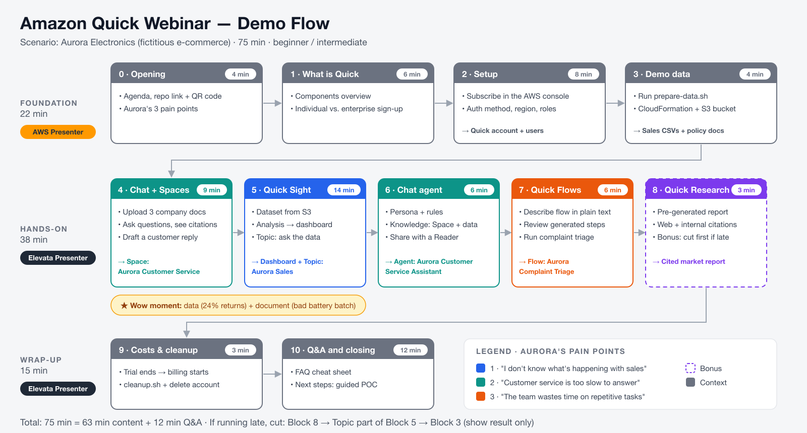

# Presenter script — Webinar "Amazon Quick in practice: from zero to your first agent"

**Audience:** beginner/intermediate · **Duration:** 75 min (63 min content + 12 min Q&A)
**Format:** 2 presenters — **AWS** presents the foundation (Blocks 0–3: opening, what Amazon Quick is, setup, demo data) and **Elevata** presents the hands-on demo and wrap-up (Blocks 4–10). Each presenter narrates and drives the console in their own blocks.
**Use case:** *Aurora Electronics*, a fictitious e-commerce company that wants to (1) understand its sales, (2) answer customers faster and (3) automate repetitive tasks.



> Legend: 🎤 = suggested talking points · 🖱️ = on-screen action · ⚠️ = caution/plan B · ⏱️ = cumulative time

---

## Timing overview

| # | Block | Min | ⏱️ | Presenter | Repository lab |
|---|---|---|---|---|---|
| 0 | Opening and agenda | 4 | 0:04 | AWS | — |
| 1 | What is Amazon Quick | 6 | 0:10 | AWS | — |
| 2 | Setup (account, region, users) | 8 | 0:18 | AWS | `labs/01` |
| 3 | Demo data (S3 + CloudFormation) | 4 | 0:22 | AWS | `labs/02` |
| 4 | Chat + Spaces (company knowledge) | 9 | 0:31 | Elevata | `labs/03` |
| 5 | Quick Sight: dataset → dashboard → questions | 14 | 0:45 | Elevata | `labs/04` |
| 6 | Custom chat agent | 6 | 0:51 | Elevata | `labs/05` |
| 7 | Quick Flows (natural-language automation) | 6 | 0:57 | Elevata | `labs/06` |
| 8 | Quick Research (intermediate bonus) | 3 | 1:00 | Elevata | `labs/07` |
| 9 | Costs, governance and cleanup | 3 | 1:03 | Elevata | `labs/08` |
| 10 | Q&A and closing | 12 | 1:15 | Elevata | — |

**If you run short on time, cut in this order:** Block 8 → the *Topics* part of Block 5 → Block 3 (show only the finished result).

---

## Block 0 — Opening (4 min) ⏱️ 0:04

🎤 **AWS:** "Welcome! Today we'll start from scratch, turn on Amazon Quick in an AWS account and, in one hour, have a dashboard, a knowledge space, an AI agent and an automation up and running. Everything we do here is in the repository we'll share in the chat, with step-by-step instructions so you can redo it at your own pace."

🖱️ **AWS:** Slide with the repository link and QR code.

🎤 **AWS:** "Our fictitious customer is Aurora Electronics, an e-commerce company with three pain points: *I don't know what's happening with sales*, *customer service takes too long to answer according to our policy*, and *the team wastes time on repetitive tasks*. Each part of the demo solves one of these pain points."

🖱️ Agenda slide (table above, block names only).

---

## Block 1 — What is Amazon Quick (6 min) ⏱️ 0:10

🎤 **AWS:** "Amazon Quick is AWS's AI agent–powered workspace. It evolved from QuickSight, which is now **Quick Sight**, one of its components. Think of it as 'one place' to ask, analyze, research and automate."

🖱️ Components slide:

| Component | In one sentence | In the demo |
|---|---|---|
| **Chat / Agents** | Converse in natural language; build agents with their own instructions and knowledge | Blocks 4 and 6 |
| **Spaces** | Collaborative folders with files and data that give the AI context | Block 4 |
| **Quick Index / Knowledge bases** | Connects company documents (S3, SharePoint, Confluence…) | Mentioned |
| **Quick Sight** | BI: datasets, analyses, dashboards, natural-language questions | Block 5 |
| **Quick Flows** | Automations described in natural language, for day-to-day work | Block 7 |
| **Quick Automate** | Enterprise process automation, more robust and agent-driven | Mentioned |
| **Quick Research** | Deep research (web + your data) delivered as a cited report | Block 8 |
| **Integrations / Actions** | Connects apps (Slack, Teams, Jira, Salesforce, MCP, OpenAPI…) | Mentioned |

🎤 **AWS:** "There are two ways to get started: **individual**, at aws.com/quick, with an email and no AWS account (Free/Plus plans), or **enterprise**, through the AWS console, with IAM Identity Center or federation, AWS billing and governance. Today we'll take the enterprise path, which is what most companies use."

⚠️ Don't quote prices out loud as final. Say: "up-to-date prices are on the official pricing page; there's a 30-day trial for up to 25 users." (Details in `labs/08`.)

---

## Block 2 — Setup (8 min) ⏱️ 0:18

> **Pre-recorded or live?** Creating the account takes a few minutes, but **it can only be done once per AWS account**. Recommendation: do it live in a **brand-new sandbox AWS account** and have a 2-min **backup video**. See `PRE_WEBINAR_CHECKLIST.md`.

🖱️ **AWS:** AWS console → search for **"Quick"** (it is also under *Analytics*).

🎤 **AWS:** "First important point: whoever subscribes needs IAM permissions for Quick. In companies using AWS Organizations, check that no SCP is blocking it."

🖱️ **AWS:** Subscription screen, filling in:
1. **Quick account name**: `aurora-demo-<your-name>` (must be globally unique).
2. **Notification email**.
3. **Region**: choose the region that will hold your data (e.g., `us-east-1`). 🎤 "The region matters: the S3 data we'll use must be in the same region."
4. **Authentication method**: show the options and explain each in one sentence:
   - *Password-based or Single Sign-On* (recommended on screen, simplest to start)
   - *IAM Identity Center* (most common in companies: uses existing users and groups)
   - *Single Sign-On only* / *Active Directory*
5. **Create account** → **Go to Quick**.

🎤 **AWS:** "Done, Quick is enabled. Now let's invite people."

🖱️ **AWS:** User icon (top right) → **Manage Quick** → **Manage users** → **Invite users**. Show the roles:

| Role | What it does |
|---|---|
| **Admin** | Manages users, subscription, security and SPICE capacity |
| **Author** | Creates datasets, analyses, dashboards, agents, flows |
| **Reader** | Consumes dashboards, chats with agents, runs flows |

🎤 **AWS:** "Governance tip: start with a few *Authors* and many *Readers*. In production, manage this through IAM Identity Center **groups** instead of user by user."

🖱️ **AWS:** Still in *Manage Quick*, quickly show **Security & permissions** → **AWS resources** (we'll come back here in Block 5 to grant S3 access).

---

## Block 3 — Demo data (4 min) ⏱️ 0:22

🎤 **AWS:** "So everyone sees the same numbers, the repository has a script that generates 12 months of fictitious data and uploads everything to a private S3 bucket using CloudFormation."

🖱️ **AWS:** Terminal (large font!):
```bash
git clone <REPO-URL> && cd aws-quick-webinar
./scripts/prepare-data.sh
```

🎤 **AWS (while it runs):** "The script generates `sales.csv` with about 8,000 rows, plus `targets.csv` and `products.csv`, creates the bucket with encryption and public access blocked, uploads the company documents and creates the *manifests* Quick Sight uses to read from S3."

⚠️ **Plan B:** if the deployment is slow, show the already-created bucket in the S3 console and move on. For beginners, Block 5 also works with a **direct CSV upload**, no S3 needed.

🔁 **Hand-off — AWS → Elevata:** 🎤 **AWS:** "Our environment and data are ready. Now I'll hand over to Elevata, who will show what we can build with Amazon Quick on top of them." (Switch screen sharing to the Elevata presenter.)

---

## Block 4 — Chat + Spaces (9 min) ⏱️ 0:31

🎤 **Elevata:** "First pain point: customer service needs to answer based on company policy. Let's give the AI that knowledge with a **Space**."

🖱️ **Elevata:**
1. Left menu → **Spaces** → **Create space** → Name: `Aurora Customer Service`. Description: *Customer service team policies and materials*.
2. **Add knowledge / Upload files** → drag in the 3 files from the `documents/` folder.
3. Wait for indexing (a few seconds to a few minutes).

🎤 **Elevata:** "Spaces are like smart folders: you add files (and also dashboards, datasets and knowledge bases) and share them with your team. Everything in there becomes context for the chat."

🖱️ **Elevata:** Open the chat **inside the Space** and use the prompts from `prompts/demo-prompts.md` → *Block 4*:

1. `What is the deadline to return a defective product bought 45 days ago?`
   → 🎤 "Notice the **citation** of the document. Answer: repair center, up to 30 days for repair."
2. `A customer bought the Pulse Bluetooth Headphones 60 days ago and they stopped charging. What should I offer?`
   → 🎤 "Here the AI has to find the Audio line **exception**: immediate replacement. It's the kind of detail a human agent forgets."
3. `Write a reply to the customer John, order ORD-104448 (Pulse Bluetooth Headphones that stopped charging), following the customer service manual.`
   → 🎤 "It combined **two documents**: the policy (what to do) and the manual (how to say it)."

⚠️ If the answer is generic, check that the chat has the Space selected as a source (context/source selector in the chat box).

---

## Block 5 — Quick Sight (14 min) ⏱️ 0:45

🎤 **Elevata:** "Second pain point: understanding sales. Let's go from CSV to dashboard in a few minutes and then **ask** the data questions."

### 5.1 Grant S3 access (1 min)
🖱️ **Elevata:** User icon → **Manage Quick** → **Security & permissions** → **AWS resources** → **Amazon S3** → select the `aurora-quick-demo-...` bucket → **Save**.

### 5.2 Create the datasets (3 min)
🖱️ **Elevata:** Left menu → **Data** → **Create** → **New dataset** → **Amazon S3**.
- Name: `sales` · Manifest URL: `s3://<bucket>/manifests/sales-manifest.json` → **Connect** → **Edit/Preview data**.
- Quick type fixes: `order_date` = **Date**; `revenue`, `total_cost`, `unit_price` = **Decimal**.
- Create a calculated field: `profit = revenue - total_cost`.
- **Publish & visualize**.
- (Repeat for `targets` in the background, or have it ready beforehand.)

🎤 **Elevata:** "The data lives in **SPICE**, Quick Sight's in-memory engine, which is why queries are fast."

⚠️ **Plan B (beginner):** **Data** → **Create** → **New dataset** → **Upload a file** → `data/sales.csv`.

### 5.3 Analysis and dashboard (6 min)
🖱️ **Elevata:** In the analysis:
1. **KPI**: sum of `revenue` (filter `status = Delivered`).
2. **Line**: `order_date` (month) × `revenue` → 🎤 "Look at the Black Friday peak in November and at Christmas."
3. **Bars**: `region` × `revenue`, colored by month or filtered by half-year → 🎤 "The Northeast grows all year long."
4. **Table/Bars**: `product` × count of `order_id`, filter `status = Returned`.
5. **Pie/Donut**: `channel` × `revenue` → 🎤 "The App gaining ground."
6. Use the **analysis AI assistant** (AI icon / *Build visual*): `Show the return rate by product`.
7. **Publish** → **Publish dashboard** → name it `Aurora Sales`.

🎤 **Elevata:** "The dashboard is what business users consume. The analysis is the author's 'draft'."

### 5.4 Ask the data (4 min)
🖱️ **Elevata:** Show two ways:
- **Topics**: menu → **Topics** → **Create topic** → name `Aurora Sales`, dataset `sales`. 🎤 "A *Topic* teaches the AI your business vocabulary: synonyms, which field means 'turnover', and so on."
- **Chat**: add the dashboard/topic to the `Aurora Customer Service` Space (or create an `Aurora Sales Team` Space) and ask:
  - `Which product has the highest return rate and what is the main reason?`
  - `Did the Northeast hit its target in October 2026?` (requires the `targets` dataset)
  - `Compare App versus Website revenue over the last 6 months.`

🎤 **Elevata ("wow" moment):** "Now bring the two worlds together: the **data** shows the Pulse headphones have a 24% return rate, and the **document** explains why: a faulty battery batch. Ask: *Why do the Pulse Bluetooth Headphones have so many returns, and what is being done about it?*"

⚠️ Topic creation can take a few minutes to index. **Have a Topic ready** before the webinar and show creation only as navigation.

---

## Block 6 — Custom chat agent (6 min) ⏱️ 0:51

🎤 **Elevata:** "So far we've used the default chat. For the customer service team, we want an **agent** with a fixed personality, rules and knowledge that anyone can use without configuring anything."

🖱️ **Elevata:** Menu → **Agents** (Chat agents) → **Create agent** → you can create it **by describing it in natural language** or configure it manually:
- **Name:** `Aurora Customer Service Assistant`
- **Instructions / persona:** copy from `prompts/demo-prompts.md` → *Block 6*.
- **Knowledge:** `Aurora Customer Service` Space (+ `Aurora Sales` dashboard).
- **Sample messages / starters:** 3 frequently asked questions.
- **Launch / Publish** → **Share** with a Reader user.

🖱️ **Elevata:** Test: `I received the Pulse headphones with a defect 2 months ago, I want my money back.`
🎤 "It follows the tone of voice, cites the Audio line exception and offers immediate replacement. Since the customer asked for a refund and it's past 30 days, it explains the options correctly."

---

## Block 7 — Quick Flows (6 min) ⏱️ 0:57

🎤 **Elevata:** "Third pain point: repetitive tasks. A **Flow** is an automation you describe in plain language, and Quick builds the steps. Anyone can run it, no code required."

🖱️ **Elevata:** Menu → **Flows** → **Create flow** → paste the prompt from `prompts/demo-prompts.md` → *Block 7*:
> *Create a flow that takes the text of a customer complaint and the order number as input. Classify the complaint according to the customer service manual (category and priority), check the returns policy in the "Aurora Customer Service" Space, and generate a ready-to-send reply to the customer, plus a 3-line internal summary for the supervisor.*

🖱️ **Elevata:** Show the generated steps (input → reasoning/AI → Space lookup → outputs). Edit one step to show it can be adjusted. **Run** it with the sample complaint from the prompts file.

🎤 **Elevata:** "Flows can also **take actions** in connected apps (create a Jira ticket, send a Slack/Teams message, email) using *Integrations/Actions*. For multi-step enterprise processes with approvals and high volume, there's **Quick Automate**."

---

## Block 8 — Quick Research (3 min · bonus) ⏱️ 1:00

🖱️ **Elevata:** Menu → **Research** → new project → prompt from `prompts/demo-prompts.md` → *Block 8* → include the Space as a source.

🎤 **Elevata:** "Research builds a research plan, searches the web and your data, and delivers a report with citations. Since it takes a few minutes, **I started one before the webinar**. Let's look at the result."

🖱️ **Elevata:** Open the pre-generated report and show the **citations** and the **research plan**.

---

## Block 9 — Costs, governance and cleanup (3 min) ⏱️ 1:03

🎤 **Elevata:** key points (slide):
- **Trial:** 30 days, up to 25 users. **After the trial, billing starts automatically** unless the account is canceled.
- **Cost model:** per-user subscription + monthly account infrastructure fee + usage (SPICE, agent hours, etc.). Check the official page.
- **Security:** identity via IAM Identity Center, encryption by default (optional KMS keys), data stays in your account, permissions per user and group.
- **Cleanup:** `./scripts/cleanup.sh` removes the bucket and the stack; the Quick account is canceled under **Manage Quick → Account settings → Delete account** (`labs/08`).

---

## Block 10 — Q&A and closing (12 min) ⏱️ 1:15

🎤 **Elevata:** "To recap: in one hour we enabled Quick, gave the AI company knowledge with Spaces, built a dashboard and talked to our data, created a customer service agent and an automation. The repository has all of this as labs you can follow at your own pace."

🖱️ Final slide: repository link, team contact, next steps (guided POC, data workshop, etc.).

### Frequently asked questions (presenter cheat sheet)
- **"Is this the same as QuickSight?"** QuickSight became *Quick Sight* inside Amazon Quick. Existing APIs and dashboards keep working.
- **"Is my data used to train the model?"** No. Quick runs on AWS with your account's identity, network and compliance controls. Point to the security documentation/FAQ.
- **"Does it connect to SharePoint/Confluence/Salesforce/Jira?"** Yes, through knowledge bases, action connectors, MCP and OpenAPI.
- **"Does it work in Teams/Slack/Chrome?"** Yes: browser extensions, a desktop app and integrations with Slack, Teams and Microsoft 365.
- **"Flows vs Automate?"** Flows: personal and team automations built in natural language. Automate: end-to-end enterprise processes with orchestration and scale.
- **"Which region?"** Availability varies; check the list of regions in the documentation before choosing.
